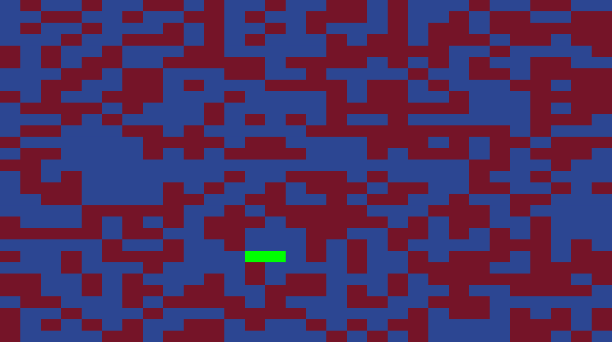

# Wolff Sweep

A p5.js visualization of cluster updates on a two-dimensional Ising spin lattice using the Wolff algorithm. Randomly initialized spins form a colorful, evolving grid, with growing clusters highlighted in green.



## How it works

The sketch creates a 30 × 30 square lattice with periodic boundaries: sites at opposite edges are neighbors. Each update starts from a random site and grows a cluster by adding neighboring spins with the same orientation with probability

```text
p = 1 - exp(-2J / T)
```

The spins in the cluster are then flipped. Blue and burgundy represent the two spin states; green marks sites added to the current cluster.

The default settings are temperature `T = 1.8`, coupling `J = 1.0`, and a target frame rate of 5 frames per second. The canvas fills the browser window.

## Run locally

From the project directory, start a local web server:

```sh
python3 -m http.server 8000
```

Open `http://localhost:8000` in your browser. The p5.js libraries are included in `libraries/`, so no package installation is required.

## Save an animation

Press **s** while the sketch is running to record a 25-second GIF after a one-second delay. The browser downloads it as `wolff_sweep_animation.gif`.

## Customize

Edit `sketch.js` to change:

- **Grid size:** the row and column counts in `new square_lattice(30, 30, ...)` inside `setup()`.
- **Colors:** `up_color`, `down_color`, and `cluster_color` inside `setup()`.
- **Update rate:** `frameRate(5)` inside `setup()`.
- **Temperature and coupling:** `lat0.wolff_sweep(1.8, 1.0)` inside `draw()`.
- **Recording duration:** the duration argument in `saveGif()` inside `keyPressed()`.

## Files

- `sketch.js` — lattice construction, cluster updates, rendering, and GIF recording.
- `index.html` — browser entry point and library loading.
- `style.css` — page styling.
- `libraries/` — bundled p5.js and p5.sound libraries.
- `results/wolff_sweep_animation.gif` — animation preview embedded above.
